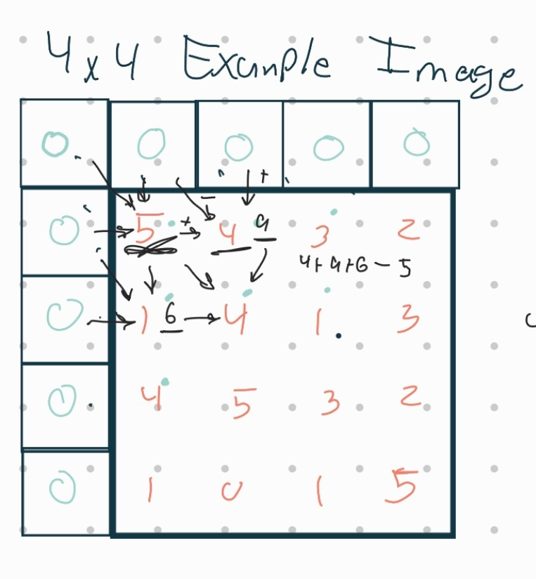

<h3 style="text-decoration:underline">R3 - EE516: Life with Adly Fam</h3>

Recruitment and perspective

 
By far one of the most "impactful" classes that I took during the course of my graduate
degree was EE516 - Introduction to Digital Signal Processing. Yes that's right EE516, perhaps one of the most infamous courses of the electrical engineering department taught by one of the most infamous faculty, Dr. Adly Fam. My reason for registering for this course was straight forward, but some of my take-aways were surprising. Unsurprisingly, We covered many fundamental topics to our modern digital world in lecture style that confounded some, I took enjoyment from. I walked away from the class with a much better, intuitive understanding of discrete-time systems, digital filters, a fun final project, and all sorts of wild ideas. Equally as important, I walked away having gained a new perspective on the academic world and some of the characters within it, as well as a deeper understanding of my own limitations.  

Like I mentioned before, my reason for registering for this course was pretty straight forward. Just a few months prior I had started my first full time job as a firmware engineer. On a daily basis I needed to work hands-on with control systems implemented in digital hardware. Perfect! After talking with my mentor, Dr. Fritz assured me that this would be a great course to take and that I would probably enjoy it too. With an attitude of ambition I walked into class on the first day, prepared to soak up all the knowledge possible hoping that at the end of the course, I could walk into work with a few more black-box breaking tools in my back pocket. 

Things really did start normally for the first class or so. He reviewed some material that we had covered in EE202, Signals and Systems and reintroduced the idea of discrete time systems. In other words, how to work with equations when time is no longer continuous, but instead occurs in individual chunks. There were even some nicely prepared slide shows and PDFs that he would work through. It was clear that although he was eccentric, he was quite passionate. I always find this to be a positive, if not entertaining, attribute in a professor. 

Things started to get more interesting the first time I had a discussion with him after class. He had frequently mentioned that a large part of one's course grade would rely on the merit of a final project. Being a self-labeled "creative-thinker" with a fresh new job at one of the more coveted companies in Buffalo, I was eager to receive some feedback on my admittedly half-baked ideas. Initially, I sensed that Dr. Fam saw through me to some degree; something in his body language seemed dismissive. That was until he discovered that I worked on a daily basis with his former PhD student, Dr. Fritz. After this fact came to light, it was like someone flipped a switch on his perception of me. All of this is important context for my experience through the remainder of his class.

From that point onward, it became clear as to how this course and its instructor had earned their infamy. Also from this point onward, it seemed that I could do no wrong. Surely such a close disciple of Doctor Christopher Fritz could easily understand the course material and would manifest a worthy final project. I will be the first to say that I am never the smartest person in the
room. With that in mind,  Dr. Fam's perception of me left me in a tenuous position. To say the least, I would choose my words carefully.

A few more weeks into class I realized why this course was often regarded as difficult or confusing: it had very little structure. I loved it. After the first few classes, Dr. Fam switched to a different style of teaching. Instead of slides, he would introduce a topic, generally, and then proceed to explain the intricacies of the subject using nothing more than pen and a blanksheet of paper. We discussed the back bone of DSP, the Finite Impulse Response filter, all the way to arcane topics of radar and orthogonal-frequency division multiplexing, taking many tangents in between. There were no slide shows, just Dr. Fam teasing out beautiful, fundamental, mathematical concepts through a series of poorly drawn ones and zeros on the page. It became clear that Dr. Fam was teaching this class for a very specific reason and for a very specific set of students. 

This class was for the curious. There would be no homework submissions or tests. There would not be a rubric upon which your final project would be graded. This class was not being taught for the students who calculated the exact point value of a passing grade. And if you asked about any such things, you would receive a response of bewilderment, and possibly, a mild chastising. This was a class taught for the student who was so interested in the topics at hand, that they would explore the topics and questions posed by Dr. Fam in their own free time. Knowing the type of person that I am, this was exactly the type of class that I thrived in, and I immensely enjoyed experimenting with the math and code presented in class. But this methodology was somewhat of a facade; this class was not a charitable sanctuary for free-thinking students. 

No, it became clear that this class served as a recruitment arena. Doctor Adly Fam had devised an ingenious tactic to draw curious minds into his circle of influence by dangling tantalizing topics in front of them, at which point he would attempt to bribe said students with promises of patents, papers, and the title "Doctor" forever in front of their name. All of this fame and fortune coming at the small price that he be listed (justifiably) as a coauthor on whatever results you inevitably publish. 

The technical topics that Dr. Fam discussed were deeply interesting, elegant, and seemingly endless. I was able to walk away from the class with a  fundamental understanding of the discrete time "Z-domain," digital filters and fourier transforms. We even covered more esoteric topics like radar, orthogonal-frequency division multiplexing, and various image processing techniques. I believe that even these more tangential topics strengthened my abilities as a professional engineer. Moreover, while I may not have memorized the exact content of the course, the intuition that I developed was invaluable. Of course, with an instructor like Adly Fam, I had plenty of non-technical take-aways too.

For starters, something really clicked for me in regards to the motivation of others. I realized during this class that there are some people who simply have a different measure of success. In media, pop culture, and day-to-day life you don't have to look far to see that most people define success in a pretty similar way. Most of the time, this is some combination of wealth, beauty, health. Justifiably so, who doesn't want to live a long life of fame and
fortune? There are entire industries whose sole focus is selling you the latest product or service that will finally make you successful i.e. "happy."

Interestingly, I realized that Dr. Fam does not belong to such a group of people. Instead, he is part of a group who measures success not in sports cars, but in publications. For this group of people, papers are their currency and reputations are their assets. I'm talking about the world of "academia." 

I say that this "clicked" for me because I had been briefly exposed, and confused, by this world during my time as an undergraduate researcher at Michigan State University. Who were these people that I was meeting with twice a week? They were all students, some of them already had doctorates. Doesn't that mean you are done with school? Go out and get a job! You've done as much school as you need, I promise! What's all this business with "conferences" and "posters" and "charts?" And, who is this guy who is sort of like my boss but also a professor?

Now everything was clear though, and Dr. Fam's class is what made me realize there really can be different definitions of success in life. These people want to be paid, yes, but they are also motivated by a deep interest in their field (and also tenure). I think it takes a special type of person to go to be in college for eight years and say "That was interesting, more please!" At the risk of sounding melodramatic, I would even call it noble. At the end of the day, some of these people have sacrificed a traditional career full of eight hour days and exchanged it grueling hours in a lab and endless late nights writing grant proposals. All this for the ultimately selfless goal of exploring and explaining the world around then, advancing "us" as a whole.  

In addition to learning more about the academic world, this class also made me realize that I probably wasn't cut out for it, no matter how badly I wanted to be. Despite the disproportionate attention and solicitation I received due to my relationship with Dr. Fritz, I still eventually earned the moniker of "Neutron Star" from Dr. Fam. He claimed that I was "too unstable," jumping from topic to topic and never being to focus on just one piece of potential PhD fodder like he wanted. I think that is okay.

In the end, I am at peace with the fact that I don't want to spend my whole life dedicated to a niche field of study. I like to tinker and explore on my terms, even if that means that I don't get to have a fancy prefix in front of my name. I still put in the work, and produced an ultimately inconsequential final presentation on "Integral Images." I received full marks on the presentation and an A in the course. I suspect, however, this was yet another one of Adly Fam's tactics... 

  

    
  

  

    
  

<figcaption style="text-align:center; margin-bottom: 50px ">
    Fig. 1. Hand Calculation of Toy Integral Image (photo by author) %}
</figcaption>

<figcaption style="text-align:center; margin-bottom: 50px ">
    Fig. 2. Real Integral Image (photo by author)
</figcaption>

    References

