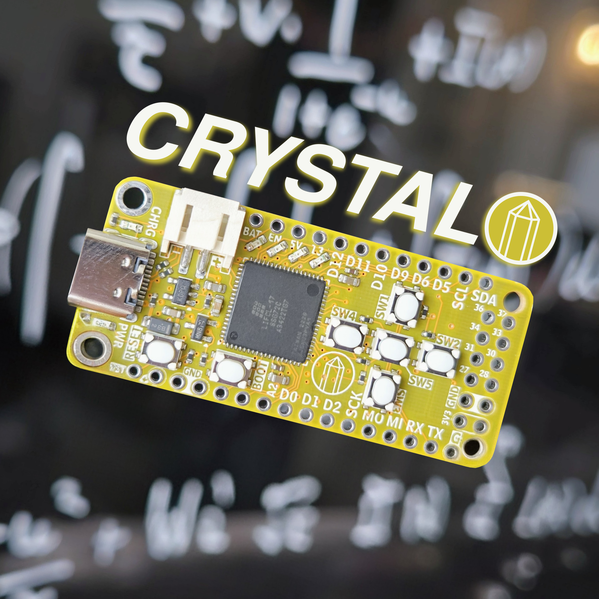
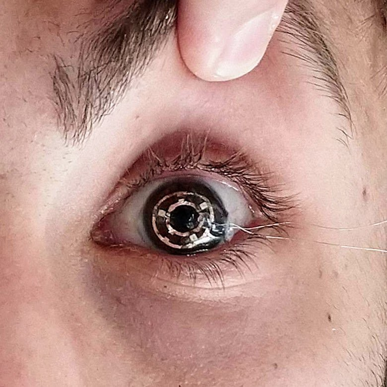
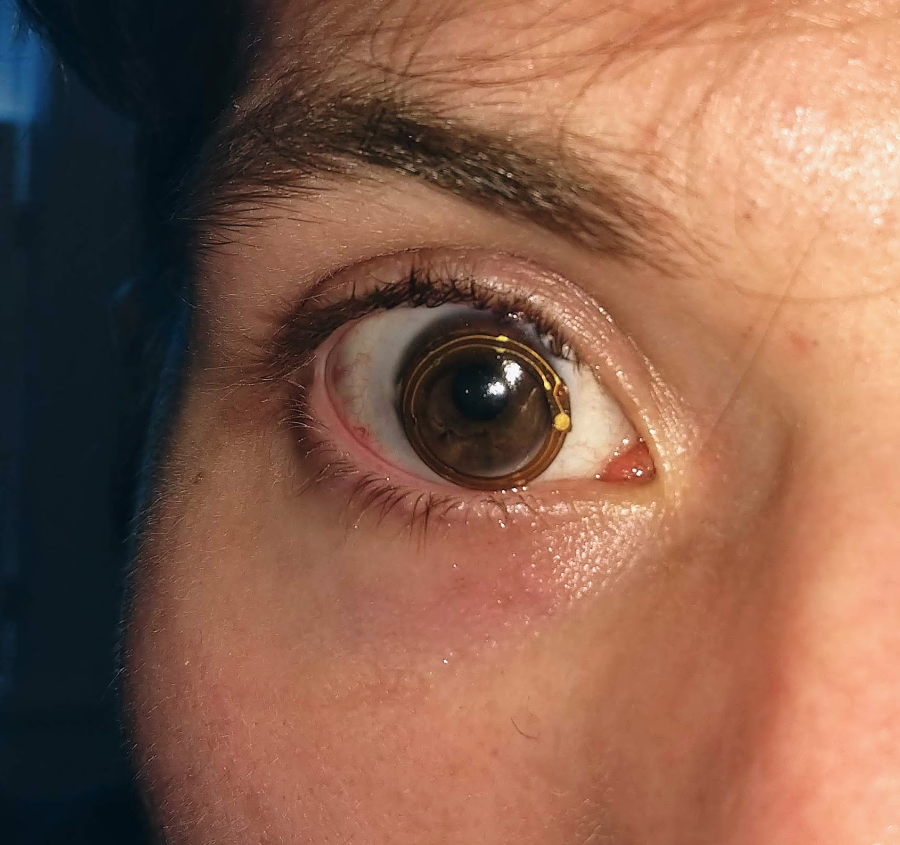

I've always been a big fan of personal projects. Some of
my most most valuable skills I've learned have been through hard-won battles with
finicky electronics or curiosity-driven deep dives, all on my own time and
dollar. 

But the best engineers I know, blend theory and application, built on top of a strong
foundation of curiosity. In other words, being I able say "I wonder what happens
if..." while also being able to analyze and explain any (potentially disastrous)
consequences 

I've had my fair share of failures and successes when it comes to my own
personal projects. Here are some of my more notable entires.

### Crystal FPGA Board 

<!--
-->

		

	

		

			I've been involved with the EE478 Digital Design course at SUNY University at Buffalo for
			a number of years now. In 2025, I even had the pleasure of being a temporary
			adjunct professor and teaching the class for part of the year. This course deals
			primarily focuses on FPGAs, with students renting a Xilinx Zybo board from the
			department. Every year, there are always a handful of promising students who
			want to keep experimenting with their FPGAs. These boards are expensive, so the
			department must inevitably yank them away. 
		

		

			This is not a unique problem to UB. There are essentially zero obtainable
			alternatives for the average college student. With that in mind, I been
			developing the Crystal FPGA Board. The board is based on
			a Lattice CrossLink-NX and is compatible with the Adafruit Feather ecosystem and
			comes in at a $50 price point - about half the cost of the norm.  
			If you'd like to learn more I have project logs on my <a hreg="https://hackaday.io/project/205055-the-crystal-board"><u>project
			page</u></a>
			

			

			I'm also very proud to say that the project was <a
			href="https://www.hackster.io/news/a-50-feather-compatible-fpga-for-makers-708015c6f4aa"><u>covered
			by Hackster.io!</u></a>
			

	

	

### Cyborg-Eyeball Project

	

		

			This is one of those "I wonder if I could..." projects that ultimately didn't lead
			anywhere but made some for great pictures and received a decent amount of
			attention. I've always had an interest in all things cyberpunk and bio-hacking.
			When it comes to the cyberpunk aesthetic, nothing can beat a pair of glowing,
			digital eyes. I knew it was a silly, somewhat dangerous idea. To all the
			concerned citizens of the internet that commented on the well being of my
			eyeballs my response with steadfast: "I'm risking my eyeballs so you don't
			have to!"
		

		

			Evidently this project was flashy enough to attact the attention of PC Gamer
			magazine with the headline of:
			

				<a href="https://www.pcgamer.com/cyberpunk-2077-eye-mod-real-life/"><u> This
				real life Cyberpunk 2077 eye mod makes my skin crawl</u></a>
			

		

		 
		

			Fair enough.
		

	

	

		

			
		

		

			
		

	

### Computationally Assessing Diamond as an Ultrafast Pulse Shaper

During my undergraduate degree, I had the privilege of conducting research on
behalf of Michigan State University. My work involved performing TCAD
simulations of diamond-based diodes under <a
href="https://engineering.msu.edu/directory/faculty/serbar"><u>Sergey
Baryshev</u></a>. These devices could be used to create ultra-fast (10s of picoseconds),
very high power pulses of electrical energy, which is extremely useful in the
field of power electronics and radar.

Diamond is considered to be a wide-bandgap semiconductor (the widest, actually)
and is theoretically the most thermal conductivity material possible. Combine
this with a very high electron-mobility and extreme tolerance to high-voltage
breakdown, it's a prime candidate for future high power semiconductor devices.

While not exactly a personal project, this effort is one of those unique 
experiences that not only helped me learn some deeply interesting physics, but
also gave me a unique edge in my professional life. 

We even managed to get a paper published on the topic. Not bad for an undergrad!

<object data="/assets/diamond_diodes.pdf" type="application/pdf" width="100%" height="600px">
  
Alternative text: <a
  href="https://www.frontiersin.org/journals/carbon/articles/10.3389/frcrb.2023.1230873/full">Frontiers
  in Carbon</a>.

</object>

